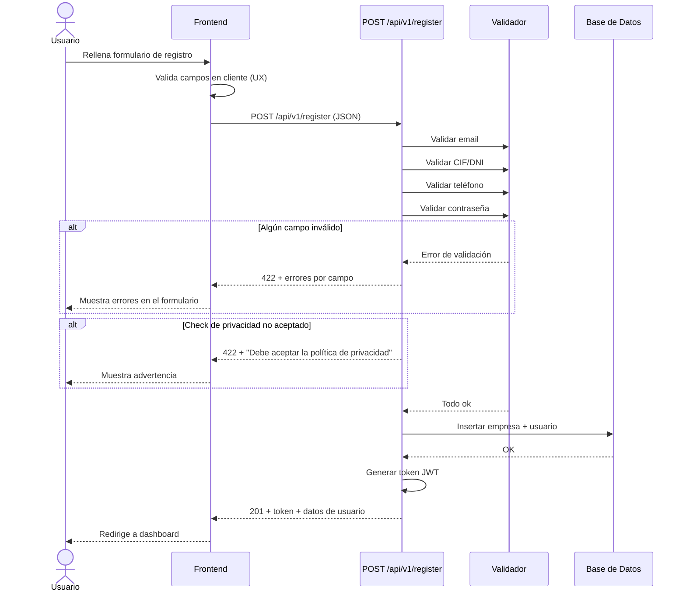

# Design — Registro

> Documento de diseño del módulo de registro basado en los requisitos de `02-registro.md`

---

## 1. Requisitos en notación EARS

Los RF originales traducidos a EARS (Easy Approach to Requirements Syntax).

### R1 — Registro de empresa

```
CUANDO el usuario envía el formulario de registro con todos los campos
válidos, el sistema DEBE crear la empresa y redirigir al usuario a la
página principal.

SI el usuario no acepta la Política de Privacidad ENTONCES el sistema
DEBE mostrar un mensaje: "Debe aceptar la política de privacidad para
registrarse" y NO DEBE crear la empresa.

SI el usuario deja algún campo obligatorio vacío ENTONCES el sistema
DEBE mostrar un mensaje indicando qué campo falta.
```

### R2 — Validación de campos

```
CUANDO el usuario introduce un email ENTONCES el sistema DEBE verificar
que contiene "@" y un dominio válido.

CUANDO el usuario introduce un CIF/DNI ENTONCES el sistema DEBE
parsearlo y comprobar que los dígitos de control son correctos.

CUANDO el usuario introduce un teléfono ENTONCES el sistema DEBE
verificar que corresponde a un teléfono fijo o móvil español.

CUANDO el usuario introduce una contraseña ENTONCES el sistema DEBE
verificar que tiene al menos 10 caracteres e incluye mayúsculas,
minúsculas, números y carácteres especiales.
```

### R3 — Mensajes de error

```
SI algún campo no cumple las reglas de validación ENTONCES el sistema
DEBE mostrar un mensaje de error específico junto al campo, indicando
la regla incumplida, en menos de 200ms.
```

### R4 — Rendimiento

```
MIENTRAS el sistema procesa un registro, el tiempo total DEBE ser
inferior a 500ms.
```

---

## 2. Arquitectura

### 2.1 Ubicación en el proyecto

El registro es un módulo independiente dentro del backend:

```
src/
├── register/
│   ├── router.py      # Endpoints
│   ├── schemas.py     # Pydantic (entrada/salida)
│   ├── models.py      # SQLAlchemy
│   ├── services.py    # Lógica de negocio
│   ├── validators.py  # Validaciones (CIF, NIF, teléfono)
│   ├── dependencies.py# Inyección de dependencias
│   └── exceptions.py  # Errores específicos
└── shared/
    └── ...
```

### 2.2 Stack

| Componente | Tecnología |
|------------|-----------|
| Framework  | FastAPI |
| ORM        | SQLAlchemy 2.x |
| BD         | PostgreSQL |
| Auth       | JWT (access + refresh) |

### 2.3 Flujo de datos



---

## 3. Decisiones técnicas

### 3.1 Validación de CIF/DNI

Se implementará una librería propia en `validators.py` con los algoritmos oficiales:
- **DNI**: Módulo 23 sobre los 8 dígitos para obtener la letra correcta.
- **CIF**: Algoritmo de dígito de control específico para personas jurídicas.
- **NIE**: Letra inicial X/Y/Z se convierte a 0/1/2 y se aplica algoritmo DNI.

### 3.2 Contraseña

Se usará `passlib` con `bcrypt` para hashear la contraseña. La validación de fortaleza se hará en cliente y servidor.

### 3.3 Política de Privacidad

El campo `accept_privacy_policy` será booleano obligatorio en el schema. Si es `false`, el servicio lanza excepción antes de tocar BD.

---

## 4. Alternativas descartadas

| Alternativa | Descartada porque... |
|-------------|---------------------|
| **Validar CIF/DNI con API externa** | Dependencia de terceros, coste, latencia. Mejor implementar la lógica local. |
| **Usar sesiones en vez de JWT** | El registro debe devolver un token para que el usuario entre sin hacer login extra. JWT es stateless. |
| **Registro en dos pasos (verificar email)** | Complejidad innecesaria para la primera versión. Se añadirá en el futuro si es necesario. |

---

## 5. Test Strategy

| Test | Qué verifica | Cubre R |
|------|-------------|---------|
| `test_register_success` | Registro completo y redirección | R1 |
| `test_register_missing_field` | Error por campo obligatorio vacío | R1 |
| `test_register_invalid_cif` | Error por CIF mal formado | R2 |
| `test_register_invalid_dni_letter` | Error por letra de DNI incorrecta | R2 |
| `test_register_weak_password` | Error por contraseña débil | R2 |
| `test_register_privacy_not_accepted` | Error por no aceptar políticas | R1 |
| `test_register_response_time` | Tiempo de respuesta < 500ms | R4 |