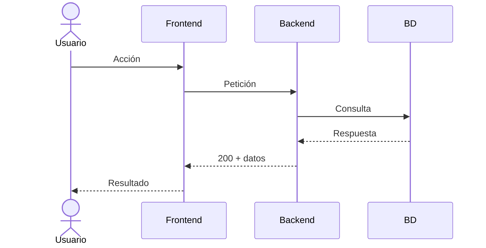

# Guía de diseño de aplicaciones

> Proceso paso a paso para diseñar una aplicación, desde la idea hasta los
> requisitos listos para implementar.

---

## Índice

1. [Descubrimiento](#1-descubrimiento)
2. [Captura de requisitos](#2-captura-de-requisitos)
3. [Especificación funcional (RF + EARS)](#3-especificación-funcional-rf--ears)
4. [Especificación no funcional (RNF)](#4-especificación-no-funcional-rnf)
5. [Historias de usuario](#5-historias-de-usuario)
6. [Criterios de aceptación](#6-criterios-de-aceptación)
7. [Priorización (MoSCoW)](#7-priorización-moscow)
8. [Diseño técnico](#8-diseño-técnico)
9. [Diagramas UML](#9-diagramas-uml)
10. [Estrategia de tests](#10-estrategia-de-tests)
11. [Tareas de implementación](#11-tareas-de-implementación)
12. [Checklist de calidad](#12-checklist-de-calidad)
13. [Arquitectura y stack tecnológico](#13-arquitectura-y-stack-tecnológico)
14. [Resumen: la secuencia completa](#14-resumen-la-secuencia-completa)

---

## Estructura de archivos

Todos los documentos viven en `docs/`. Este es el resultado de seguir la guía:

```bash
docs/
├── guia-diseno-aplicaciones.md    # Esta guía (proceso, humanos)
├── 01-problema_detectado.md       # Paso 1  — problema, actores
├── 02-architecture.md             # Paso 13 — arquitectura, filosofía, patrones
├── 03-conventions.md              # Estándares de código
├── 04-tech-stack.md               # Paso 13 — tecnologías y versiones
│
├── ai/                            # Proceso para la IA
│   ├── specs.md                   # Cómo se escriben las specs (SDD)
│   └── verification.md            # Estrategia de tests
│
└── modulos/                       # Una carpeta por módulo
    ├── registro/
    │   ├── requirements.md        # Pasos 2-7  — requisitos
    │   ├── design.md              # Pasos 8-10 y 12 — diseño técnico
    │   └── tasks.md               # Paso 11 — tareas de implementación
    ├── login/
    │   ├── requirements.md
    │   ├── design.md
    │   └── tasks.md
    └── documentos/
        ├── requirements.md
        ├── design.md
        └── tasks.md
```

### Reglas de nombrado

- **Globales** (en `docs/`): `01-problema_detectado.md`, `02-architecture.md`, `03-conventions.md`, `04-tech-stack.md`.
- **Proceso IA** (en `docs/ai/`): `specs.md`, `verification.md`.
- **Por módulo** (en `docs/modulos/<modulo>/`): `requirements.md`, `design.md`, `tasks.md`.
- El nombre de la carpeta es el módulo en minúsculas (`registro`, `login`, `documentos`).

---

## 1. Descubrimiento

**Objetivo**: Entender el problema, el usuario y el contexto antes de escribir nada.

### Pasos

1. **Define el problema en una frase**:
   - Ejemplo: *"Las empresas no tienen un lugar centralizado donde guardar documentos de la vida laboral de sus trabajadores."*

2. **Identifica los actores**:
   - ¿Quién usa el sistema? (admin, empresa, trabajador, RRHH)
   - ¿Quién se beneficia?
   - ¿Quién paga?

3. **Lista los módulos principales**:
   - Separa por funcionalidad (registro, login, documentos, notificaciones...)
   - Cada módulo será un documento independiente.

**Formato**: Crea un `docs/01-problema_detectado.md` con esta estructura:

```markdown
# <nombre del proyecto>

## Problema detectado
<descripción del problema en una frase>

## A quién le pasa (target)
<quiénes son los afectados: RRHH, empresas, autónomos...>

## Gravedad de la molestia
<cómo de grave es el problema para el cliente>

## Quien se veneficia
<>

## Quien Paga
<>
```

> **Estructura por módulo**: Cada módulo genera una carpeta
> `docs/human/<modulo>/` con **tres archivos**:
> - `requirements.md` — requisitos (RF, RNF, HU, CA, MoSCoW) → pasos 2 a 7
> - `design.md` — diseño técnico (decisiones, UML, tests, checklist) → pasos 8 a 10 y 12
> - `tasks.md` — tareas de implementación → paso 11
>
> Ejemplo: `docs/modulos/registro/{requirements,design,tasks}.md`

---

## 2. Análisis de requisitos

**Objetivo**: Extraer qué debe hacer cada módulo hablando con stakeholders o simulando el producto.

### Técnicas

- **Entrevista**: Pregunta abierta al cliente/usuario.
  - *"¿Qué necesitas poder hacer?"*
  - *"¿Qué pasa si falla?"*
  - *"¿Cuántos usuarios lo usarán?"*
- **Observación**: Mira cómo trabajan hoy sin la app.
- **Prototipo rápido**: Dibuja pantallas en papel o Figma.

### Por cada módulo, responde

| Pregunta | Para qué sirve |
|----------|----------------|
| ¿Qué formularios/pantallas tiene? | Para listar campos (RF) |
| ¿Qué validaciones tiene cada campo? | Para escribir reglas (RF) |
| ¿Qué ocurre si todo va bien? | Happy path (CA) |
| ¿Qué ocurre si algo falla? | Error paths (CA) |
| ¿Cuánto tiempo debe tardar? | Rendimiento (RNF) |

---

## 3. Especificación funcional (RF + EARS)

**Objetivo**: Escribir qué debe hacer el sistema. Se puede hacer en RF clásicos o en notación EARS.

### Opción A — RF clásicos (bullet points)

```bash
RF1 - Registro:
    RF1a: Nombre de la empresa.
    RF1b: CIF o DNI.
    ...
```

### Opción B — EARS (recomendado)

EARS usa 5 patrones fáciles. Cada requisito es una frase con verbo duro (`DEBE` / `NO DEBE`).

| Patrón | Cuándo usarlo | Plantilla |
|--------|---------------|-----------|
| **Ubicuo** | Siempre | `El sistema DEBE <acción>.` |
| **Evento** | Cuando pasa algo | `CUANDO <disparador>, el sistema DEBE <acción>.` |
| **Estado** | Mientras dure algo | `MIENTRAS <estado>, el sistema DEBE <acción>.` |
| **Opcional** | Solo si aplica | `DONDE <condición>, el sistema DEBE <acción>.` |
| **No deseado** | Errores | `SI <error> ENTONCES el sistema DEBE <acción>.` |

Ejemplo:

```html
CUANDO el usuario introduce un email, el sistema DEBE validar que
contiene "@" y un dominio.

SI el email no es válido ENTONCES el sistema DEBE mostrar un mensaje
de error junto al campo.
```

### Reglas EARS

- Cada requisito tiene un ID único: `R1`, `R2`, `R3`...
- Cada requisito debe ser verificable por un test.
- No mezcles varios `DEBE` en una misma frase.
- No uses verbos blandos ("podría", "debería", "soporta").

---

## 4. Especificación no funcional (RNF)

**Objetivo**: Definir cómo debe ser el sistema (rendimiento, seguridad, disponibilidad).

### Tipos comunes

| Tipo | Ejemplo |
|------|---------|
| Rendimiento | "El registro debe durar menos de 500ms" |
| Seguridad | "Las contraseñas se almacenan hasheadas con bcrypt" |
| Disponibilidad | "El sistema debe estar disponible 99.5%" |
| Usabilidad | "Los mensajes de error aparecen en menos de 200ms" |

Preguntas para detectar RNF:

- ¿Cuántos usuarios concurrentes?
- ¿Cuánto tiempo puede tardar una operación?
- ¿Qué pasa si la BD cae?
- ¿Hay que cumplir normativas? (GDPR, LOPD, PRL...)

---

## 5. Historias de usuario

**Objetivo**: Validar que los requisitos cubren las necesidades reales desde la perspectiva del usuario.

Formato:

```
Como [ACTOR], quiero [OBJETIVO] para [BENEFICIO].
```

Ejemplo:

```
Como EMPRESA, quiero registrarme para poder gestionar los documentos
de mis trabajadores.
```

No sustituyen a los RF: las historias de usuario son una perspectiva complementaria para detectar lagunas.

---

## 6. Criterios de aceptación

**Objetivo**: Definir cuándo una funcionalidad está terminada. Se escriben en formato **Given-When-Then** (Dado-Cuando-Entonces).

```
CA1 - DADO que el usuario rellena todos los campos correctamente
       CUANDO pulsa "Registrarse"
       ENTONCES se crea la empresa y se redirige al dashboard.

CA2 - DADO que el usuario no acepta la política de privacidad
       CUANDO pulsa "Registrarse"
       ENTONCES ve un mensaje: "Debe aceptar la política de privacidad".
```

Cada CA debe poder ejecutarse como un test al final.

---

## 7. Priorización (MoSCoW)

**Objetivo**: Decidir qué se hace primero y qué se deja para después.

| Categoría | Significado | Ejemplo |
|-----------|-------------|---------|
| **Must** | Imprescindible para el MVP | Registro, Login |
| **Should** | Importante pero no bloqueante | Validación de CIF |
| **Could** | Deseable si hay tiempo | Verificación de email |
| **Won't** | Explícitamente fuera de alcance | App móvil nativa |

---

## 8. Diseño técnico

**Objetivo**: Decidir cómo se implementa el módulo antes de escribir código.

### Contenido de un design doc

```
docs/modulos/
├── registro/
│   └── design.md
├── login/
│   └── design.md
└── ...
```

Cada design doc incluye:

1. **Arquitectura**: ¿Dónde se ubica en el proyecto? ¿Módulo nuevo o existente?
2. **Stack**: ¿Qué librerías o servicios usa? (FastAPI, SQLAlchemy, JWT...)
3. **Decisiones técnicas**: ¿Por qué se elige una opción frente a otra?
4. **Alternativas descartadas**: Qué se consideró y por qué se rechazó.
5. **Diagramas UML**: Secuencia, clases, o el que aplique.
6. **Mapa requisito → test**: Cada R debe tener al menos un test.

---

## 9. Diagramas UML

**Objetivo**: Visualizar el flujo de la funcionalidad para detectar problemas antes de implementar.

### Diagrama de secuencia (el más útil)

Muestra la interacción entre actores y sistemas en el tiempo.



Úsalo para:
- Flujo principal (happy path)
- Flujos alternativos (errores, campos inválidos)
- Flujos de excepción (BD caída, token expirado)

### Otros diagramas útiles

| Diagrama | Para qué sirve |
|----------|----------------|
| **Clases** | Modelos de datos y sus relaciones |
| **Estado** | Ciclo de vida de un objeto (ej: documento: pendiente → válido → caducado) |
| **Flujo** | Procesos de negocio complejos |

---

## 10. Estrategia de tests

**Objetivo**: Asegurar que cada requisito se puede verificar con un test.

> Este proyecto usa **solo tests de integración** con TDD.
> Cada test se escribe **antes** de implementar el endpoint que verifica.

### Enfoque TDD con integración

1. Escribe el test de integración (HTTP → BD real de prueba).
2. Ejecútalo — falla (el endpoint no existe).
3. Implementa endpoint, validadores, servicio y todo lo necesario.
4. El test pasa.
5. Refactoriza si es necesario.
6. Siguiente escenario.

### Mapa de trazabilidad

Cada escenario de prueba corresponde a un requisito:

| Test | HTTP esperado | Cubre R |
|------|--------------|---------|
| `test_register_success` | 201 + token | R1 |
| `test_register_missing_field` | 422 + campo faltante | R1 |
| `test_register_privacy_not_accepted` | 422 + mensaje privacidad | R1 |
| `test_register_invalid_cif` | 422 + error cif | R2 |
| `test_register_invalid_dni_letter` | 422 + error letra DNI | R2 |
| `test_register_weak_password` | 422 + error contraseña | R2 |
| `test_register_invalid_phone` | 422 + error teléfono | R2 |
| `test_register_invalid_email` | 422 + error email | R2 |

No se prueban validadores de forma aislada. Cada test cubre el flujo completo desde la petición HTTP hasta la respuesta, pasando por validación, servicio y BD.

---

## 11. Tareas de implementación

**Objetivo**: Lista ordenada de pasos para implementar el módulo siguiendo TDD.

### Formato

Un checklist por módulo en `docs/modulos/<modulo>/tasks.md`. Cada tarea referencia al menos un `R<n>`.

Las tareas siguen el ciclo TDD por escenario:

```
Para cada escenario (success, error CIF, error email...):
  1. Escribir test de integración → falla
  2. Implementar el código necesario → pasa
  3. Pasar al siguiente escenario
```

Ejemplo:

```markdown
- [ ] T1 — Escribir test_register_success (falla). Cubre: R1.
- [ ] T2 — Crear modelo Company, schema, servicio y endpoint (pasa). Cubre: R1.
- [ ] T3 — Escribir test_register_invalid_cif (falla). Cubre: R2.
- [ ] T4 — Implementar validación de CIF en validators.py (pasa). Cubre: R2.
```

### Reglas

- Primero el test (falla), luego el código (pasa).
- Las tareas se agrupan por escenario, no por archivo.
- Al finalizar, todos los tests deben pasar y todas las tareas marcadas `[x]`.

**Formato**: Crea un `docs/modulos/<modulo>/tasks.md`.

---

## 12. Checklist de calidad

Antes de dar por terminado un módulo, revisa:

- [ ] ¿Cada campo obligatorio tiene su validación?
- [ ] ¿Cada validación tiene su mensaje de error?
- [ ] ¿Hay test para el happy path?
- [ ] ¿Hay test para al menos un error path por campo?
- [ ] ¿Los requisitos usan verbos duros (DEBE) sin ambigüedad?
- [ ] ¿Los RNF son medibles? (no "rápido", sino "< 500ms")
- [ ] ¿Los criterios de aceptación cubren Given-When-Then?
- [ ] ¿Hay diagrama de secuencia del flujo principal?
- [ ] ¿Cada requisito tiene un test que lo verifica?

---

## 13. Arquitectura y stack tecnológico

**Objetivo**: Definir la estructura general del sistema y elegir las tecnologías.

---

### 13.1 Arquitecturas de software (las más usadas)

| Arquitectura | En qué consiste | Cuándo usarla |
|-------------|----------------|---------------|
| **Monolito** | Toda la lógica en un solo deployable (una app, un servidor). | MVPs, equipos pequeños, apps con alcance acotado. |
| **Capas (n-tier / Layered)** | Separación en capas verticales: presentación → negocio → datos. Cada capa solo habla con la inmediata inferior. | Casi cualquier proyecto. Es la base de la mayoría de frameworks. |
| **Microservicios** | Cada funcionalidad es un servicio independiente, con su propia BD, desplegado por separado. | Equipos grandes, escalado independiente, dominios muy distintos. |
| **Hexagonal (Ports & Adapters)** | El núcleo de negocio no depende de nada externo (BD, APIs, UI). Todo se conecta mediante puertos y adaptadores. | Cuando quieres testear el negocio sin depender de infraestructura. Muy usado con DDD. |
| **Clean Architecture** | Evolución de la hexagonal. Capas concéntricas: entities → use cases → adapters → frameworks. | Proyectos grandes donde el negocio es complejo y debe mantenerse aislado. |
| **Event-Driven** | Los componentes se comunican mediante eventos (mensajes asíncronos). | Sistemas en tiempo real, integración entre servicios, procesamiento asíncrono. |
| **CQRS** | Separación entre comandos (escribir) y consultas (leer). Pueden tener modelos distintos. | Cuando leer y escribir tienen requisitos muy diferentes (ej: reads complejos, writes simples). |
| **Serverless** | Código en funciones efímeras (AWS Lambda, etc.). Sin gestionar servidores. | Eventos esporádicos, prototipos, cargas variables. |

### 13.2 Filosofías y principios

| Principio | Idea central |
|-----------|-------------|
| **SOLID** | 5 principios de diseño orientado a objetos (Responsabilidad Única, Abierto/Cerrado, Sustitución de Liskov, Segregación de Interfaces, Inversión de Dependencias). |
| **KISS** | *Keep It Simple, Stupid* — la solución más simple suele ser la mejor. |
| **YAGNI** | *You Ain't Gonna Need It* — no añadas funcionalidad hasta que realmente la necesites. |
| **DRY** | *Don't Repeat Yourself* — cada pieza de conocimiento debe tener una sola representación. |
| **Convention over Configuration** | Valores por defecto sensatos para reducir la configuración explícita. |
| **Principio de Menor Sorpresa** | El sistema debe comportarse como el usuario espera, sin sorpresas. |
| **Fail Fast** | Si algo va a fallar, que falle cuanto antes y ruidosamente. |

### 13.3 Paradigmas de programación

| Paradigma | Lenguajes representativos | Cuándo usarlo |
|-----------|--------------------------|---------------|
| **Orientado a Objetos (OOP)** | Java, C#, Python, TypeScript | La mayoría de aplicaciones empresariales. Modela el mundo como objetos con estado y comportamiento. |
| **Funcional** | Haskell, Elixir, Scala, F#, JavaScript | Procesamiento de datos, concurrencia, sistemas donde el estado mutable es problemático. |
| **Procedural / Estructurado** | C, Pascal, Go | Sistemas de bajo nivel, scripts, cuando la simplicidad es prioritaria. |
| **Reactivo** | RxJava, Project Reactor, Akka | Sistemas asíncronos, streams de datos, UI reactivas. |

### 13.4 Patrones de diseño (los más conocidos)

#### Creacionales

| Patrón | Para qué sirve |
|--------|----------------|
| **Singleton** | Una sola instancia de una clase en toda la app. |
| **Factory** | Crear objetos sin especificar la clase concreta. |
| **Builder** | Construir objetos complejos paso a paso. |

#### Estructurales

| Patrón | Para qué sirve |
|--------|----------------|
| **Adapter** | Hacer que dos interfaces incompatibles puedan trabajar juntas. |
| **Decorator** | Añadir comportamiento a un objeto sin modificar su clase. |
| **Facade** | Una interfaz simplificada para un subsistema complejo. |

#### De comportamiento

| Patrón | Para qué sirve |
|--------|----------------|
| **Observer** | Un objeto notifica a otros cuando cambia su estado. |
| **Strategy** | Seleccionar un algoritmo en tiempo de ejecución. |
| **Repository** | Abstraer el acceso a datos (muy usado con Clean Architecture). |
| **Dependency Injection** | Las dependencias se inyectan desde fuera, no se crean dentro. |

---

### 13.5 Cómo escoger una tecnología

No hay una tecnología "mejor" en abstracto. La elección depende del contexto. Este es el proceso para decidir:

#### Paso 1 — Define las restricciones duras

Son las que no puedes negociar:

- **Equipo**: ¿Qué lenguajes/frameworks conoce el equipo? El coste de aprendizaje puede matar un proyecto.
- **Cliente**: ¿Exige una tecnología concreta? (ej: "solo AWS", "Java", "WordPress")
- **Infraestructura**: ¿Hay servidores ya contratados? ¿Límites de presupuesto?
- **Tiempo**: ¿Necesitas algo funcional en 2 semanas? Olvida microservicios.

#### Paso 2 — Define los requisitos técnicos del proyecto

| Pregunta | Influye en... |
|----------|---------------|
| ¿Cuántos usuarios concurrentes? | Escalabilidad del lenguaje/framework |
| ¿Cuántos desarrolladores? | Curva de aprendizaje, ecosistema |
| ¿Es tiempo real? | Arquitectura event-driven, websockets |
| ¿CRUD simple o lógica compleja? | ORM vs raw SQL, arquitectura en capas |
| ¿Vida útil esperada? | Mantenibilidad, deuda técnica |
| ¿Necesita integración con terceros? | Ecosistema de librerías |

#### Paso 3 — Evalúa con criterios objetivos

Para cada tecnología candidata, puntúa (1-5):

| Criterio | Pregunta guía |
|----------|---------------|
| **Madurez** | ¿Cuántos años tiene? ¿Tiene comunidad grande? |
| **Ecosistema** | ¿Hay librerías para lo que necesito? ¿BD, testing, auth? |
| **Rendimiento** | ¿Cumple con los RNF de velocidad y concurrencia? |
| **Curva de aprendizaje** | ¿El equipo puede empezar a producir en < 1 semana? |
| **Documentación** | ¿La documentación oficial es buena? ¿Hay ejemplos? |
| **Mercado laboral** | ¿Es fácil encontrar desarrolladores si el equipo crece? |
| **Coste** | ¿Licencias? ¿Infraestructura? ¿Formación? |

#### Paso 4 — Descarta rápido, profundiza en 2-3 opciones

1. Haz una lista larga de candidatos.
2. Elimina los que no pasen las restricciones duras (Paso 1).
3. Elimina los que no cubran los requisitos técnicos (Paso 2).
4. De los 2-3 que queden, haz un prototipo rápido (*spike*) de 1-2 días con cada uno.
5. Elige el que mejor puntuación tenga en los criterios objetivos (Paso 3).

#### Regla práctica

> *"Escoge la tecnología más aburrida que resuelva tu problema."*

Lo más seguro es un lenguaje popular (Java, Python, TypeScript, Go), un framework estándar (Spring, FastAPI, Next.js, Gin), y una BD relacional (PostgreSQL). Innova solo donde el problema lo exija.

---

**Formato**: Crea un `docs/02-architecture.md`, `docs/04-tech-stack.md` y `docs/03-conventions.md`.

---

## 14. Resumen: la secuencia completa

```
1. Descubrimiento        → docs/01-problema_detectado.md
2. Captura de requisitos → docs/modulos/<modulo>/requirements.md (RF, RNF, RC)
3. Especificación funcional + EARS → docs/modulos/<modulo>/requirements.md
4. Especificación no funcional (RNF) → docs/modulos/<modulo>/requirements.md
5. Historias de usuario  → docs/modulos/<modulo>/requirements.md
6. Criterios aceptación  → docs/modulos/<modulo>/requirements.md
7. Priorizar (MoSCoW)    → docs/modulos/<modulo>/requirements.md
8. Diseño técnico        → docs/modulos/<modulo>/design.md
9. Diagramas UML         → docs/modulos/<modulo>/design.md
10. Estrategia de tests  → docs/modulos/<modulo>/design.md (mapa R → test)
11. Tareas implementación → docs/modulos/<modulo>/tasks.md
12. Checklist calidad    → docs/modulos/<modulo>/design.md
13. Arquitectura         → docs/02-architecture.md + docs/04-tech-stack.md + docs/03-conventions.md
```