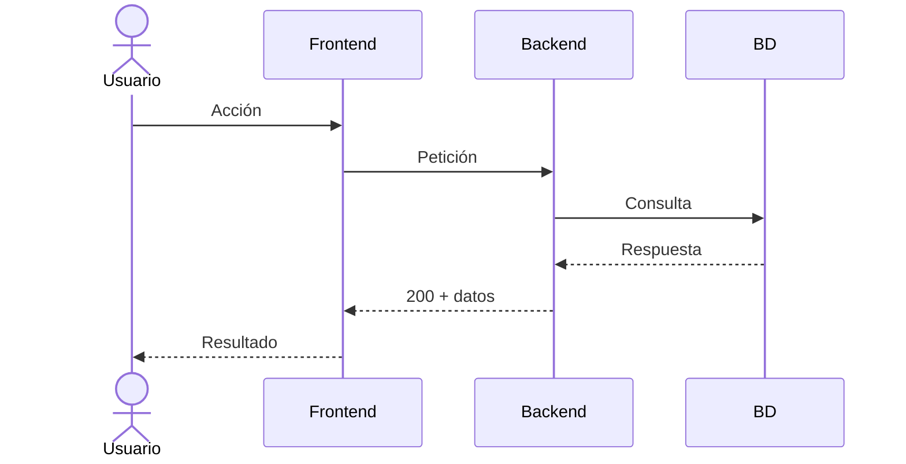

# Guía de diseño de aplicaciones

> Proceso paso a paso para diseñar una aplicación, desde la idea hasta los
> requisitos listos para implementar.

---

## Índice

1. [Descubrimiento](#1-descubrimiento)
2. [Elicitación de requisitos](#2-elicitación-de-requisitos)
3. [Especificación funcional (RF + EARS)](#3-especificación-funcional-rf--ears)
4. [Especificación no funcional (RNF)](#4-especificación-no-funcional-rnf)
5. [Historias de usuario](#5-historias-de-usuario)
6. [Criterios de aceptación](#6-criterios-de-aceptación)
7. [Priorización (MoSCoW)](#7-priorización-moscow)
8. [Diseño técnico](#8-diseño-técnico)
9. [Diagramas UML](#9-diagramas-uml)
10. [Estrategia de tests](#10-estrategia-de-tests)
11. [Checklist de calidad](#11-checklist-de-calidad)

---

## 1. Descubrimiento

**Objetivo**: Entender el problema, el usuario y el contexto antes de escribir nada.

### Pasos

1. **Define el problema en una frase**:
   - Ejemplo: *"Las empresas no tienen un lugar centralizado donde guardar documentos de la vida laboral de sus trabajadores."*

2. **Identifica los actores**:
   - ¿Quién usa el sistema? (admin, empresa, trabajador, RRHH)
   - ¿Quién se beneficia?
   - ¿Quién paga?

3. **Lista los módulos principales**:
   - Separa por funcionalidad (registro, login, documentos, notificaciones...)
   - Cada módulo será un documento independiente.

**Formato**: Crea un `01-problema-y-solucion.md` y un `02-modulos.md`.

---

## 2. Elicitación de requisitos

**Objetivo**: Extraer qué debe hacer cada módulo hablando con stakeholders o simulando el producto.

### Técnicas

- **Entrevista**: Pregunta abierta al cliente/usuario.
  - *"¿Qué necesitas poder hacer?"*
  - *"¿Qué pasa si falla?"*
  - *"¿Cuántos usuarios lo usarán?"*
- **Observación**: Mira cómo trabajan hoy sin la app.
- **Prototipo rápido**: Dibuja pantallas en papel o Figma.

### Por cada módulo, responde:

| Pregunta | Para qué sirve |
|----------|----------------|
| ¿Qué formularios/pantallas tiene? | Para listar campos (RF) |
| ¿Qué validaciones tiene cada campo? | Para escribir reglas (RF) |
| ¿Qué ocurre si todo va bien? | Happy path (CA) |
| ¿Qué ocurre si algo falla? | Error paths (CA) |
| ¿Cuánto tiempo debe tardar? | Rendimiento (RNF) |

**Formato**: Crea un `03-registro.md`, `04-login.md`, etc.

---

## 3. Especificación funcional (RF + EARS)

**Objetivo**: Escribir qué debe hacer el sistema. Se puede hacer en RF clásicos o en notación EARS.

### Opción A — RF clásicos (bullet points)

```
RF1 - Registro:
    RF1a: Nombre de la empresa.
    RF1b: CIF o DNI.
    ...
```

### Opción B — EARS (recomendado)

EARS usa 5 patrones fáciles. Cada requisito es una frase con verbo duro (`DEBE` / `NO DEBE`).

| Patrón | Cuándo usarlo | Plantilla |
|--------|---------------|-----------|
| **Ubicuo** | Siempre | `El sistema DEBE <acción>.` |
| **Evento** | Cuando pasa algo | `CUANDO <disparador>, el sistema DEBE <acción>.` |
| **Estado** | Mientras dure algo | `MIENTRAS <estado>, el sistema DEBE <acción>.` |
| **Opcional** | Solo si aplica | `DONDE <condición>, el sistema DEBE <acción>.` |
| **No deseado** | Errores | `SI <error> ENTONCES el sistema DEBE <acción>.` |

Ejemplo:

```
CUANDO el usuario introduce un email, el sistema DEBE validar que
contiene "@" y un dominio.

SI el email no es válido ENTONCES el sistema DEBE mostrar un mensaje
de error junto al campo.
```

### Reglas EARS

- Cada requisito tiene un ID único: `R1`, `R2`, `R3`...
- Cada requisito debe ser verificable por un test.
- No mezcles varios `DEBE` en una misma frase.
- No uses verbos blandos ("podría", "debería", "soporta").

---

## 4. Especificación no funcional (RNF)

**Objetivo**: Definir cómo debe ser el sistema (rendimiento, seguridad, disponibilidad).

### Tipos comunes

| Tipo | Ejemplo |
|------|---------|
| Rendimiento | "El registro debe durar menos de 500ms" |
| Seguridad | "Las contraseñas se almacenan hasheadas con bcrypt" |
| Disponibilidad | "El sistema debe estar disponible 99.5%" |
| Usabilidad | "Los mensajes de error aparecen en menos de 200ms" |

Preguntas para detectar RNF:

- ¿Cuántos usuarios concurrentes?
- ¿Cuánto tiempo puede tardar una operación?
- ¿Qué pasa si la BD cae?
- ¿Hay que cumplir normativas? (GDPR, LOPD, PRL...)

---

## 5. Historias de usuario

**Objetivo**: Validar que los requisitos cubren las necesidades reales desde la perspectiva del usuario.

Formato:

```
Como [ACTOR], quiero [OBJETIVO] para [BENEFICIO].
```

Ejemplo:

```
Como EMPRESA, quiero registrarme para poder gestionar los documentos
de mis trabajadores.
```

No sustituyen a los RF: las historias de usuario son una perspectiva complementaria para detectar lagunas.

---

## 6. Criterios de aceptación

**Objetivo**: Definir cuándo una funcionalidad está terminada. Se escriben en formato **Given-When-Then** (Dado-Cuando-Entonces).

```
CA1 - DADO que el usuario rellena todos los campos correctamente
       CUANDO pulsa "Registrarse"
       ENTONCES se crea la empresa y se redirige al dashboard.

CA2 - DADO que el usuario no acepta la política de privacidad
       CUANDO pulsa "Registrarse"
       ENTONCES ve un mensaje: "Debe aceptar la política de privacidad".
```

Cada CA debe poder ejecutarse como un test al final.

---

## 7. Priorización (MoSCoW)

**Objetivo**: Decidir qué se hace primero y qué se deja para después.

| Categoría | Significado | Ejemplo |
|-----------|-------------|---------|
| **Must** | Imprescindible para el MVP | Registro, Login |
| **Should** | Importante pero no bloqueante | Validación de CIF |
| **Could** | Deseable si hay tiempo | Verificación de email |
| **Won't** | Explícitamente fuera de alcance | App móvil nativa |

---

## 8. Diseño técnico

**Objetivo**: Decidir cómo se implementa el módulo antes de escribir código.

### Contenido de un design doc

```
design/
├── 03-registro-design.md
├── 04-login-design.md
└── ...
```

Cada design doc incluye:

1. **Arquitectura**: ¿Dónde se ubica en el proyecto? ¿Módulo nuevo o existente?
2. **Stack**: ¿Qué librerías o servicios usa? (FastAPI, SQLAlchemy, JWT...)
3. **Decisiones técnicas**: ¿Por qué se elige una opción frente a otra?
4. **Alternativas descartadas**: Qué se consideró y por qué se rechazó.
5. **Diagramas UML**: Secuencia, clases, o el que aplique.
6. **Mapa requisito → test**: Cada R debe tener al menos un test.

---

## 9. Diagramas UML

**Objetivo**: Visualizar el flujo de la funcionalidad para detectar problemas antes de implementar.

### Diagrama de secuencia (el más útil)

Muestra la interacción entre actores y sistemas en el tiempo.



Úsalo para:
- Flujo principal (happy path)
- Flujos alternativos (errores, campos inválidos)
- Flujos de excepción (BD caída, token expirado)

### Otros diagramas útiles

| Diagrama | Para qué sirve |
|----------|----------------|
| **Clases** | Modelos de datos y sus relaciones |
| **Estado** | Ciclo de vida de un objeto (ej: documento: pendiente → válido → caducado) |
| **Flujo** | Procesos de negocio complejos |

---

## 10. Estrategia de tests

**Objetivo**: Asegurar que cada requisito se puede verificar con un test.

### Mapa de trazabilidad

Para cada requisito, define al menos un test:

| Requisito | Test | Tipo |
|-----------|------|------|
| R1 | `test_register_success` | Integración |
| R2 | `test_register_invalid_cif` | Unitario |
| R3 | `test_register_weak_password` | Unitario |

### Niveles de test

1. **Unitarios**: Una función, un comportamiento. Sin BD, sin red.
2. **Integración**: API completa con BD de prueba.
3. **Aceptación**: Given-When-Then automatizados (o manuales al principio).

---

## 11. Checklist de calidad

Antes de dar por terminado un módulo, revisa:

- [ ] ¿Cada campo obligatorio tiene su validación?
- [ ] ¿Cada validación tiene su mensaje de error?
- [ ] ¿Hay test para el happy path?
- [ ] ¿Hay test para al menos un error path por campo?
- [ ] ¿Los requisitos usan verbos duros (DEBE) sin ambigüedad?
- [ ] ¿Los RNF son medibles? (no "rápido", sino "< 500ms")
- [ ] ¿Los criterios de aceptación cubren Given-When-Then?
- [ ] ¿Hay diagrama de secuencia del flujo principal?
- [ ] ¿Cada requisito tiene un test que lo verifica?

---

## Resumen: la secuencia completa

```
1. Descubrimiento        → 01-problema-y-solucion.md
2. Elicitación           → 02-modulo-X.md (RF, RNF, RC)
3. EARS                  → dentro de 02-modulo-X.md o aparte
4. Historias de usuario  → dentro de 02-modulo-X.md
5. Criterios aceptación  → dentro de 02-modulo-X.md
6. Priorizar (MoSCoW)    → dentro de 02-modulo-X.md
7. Diseño técnico        → 02-modulo-X-design.md
8. Diagramas UML         → dentro de 02-modulo-X-design.md
9. Tests                 → mapa R → test en design doc
10. Checklist final      → validar antes de dar por cerrado
```