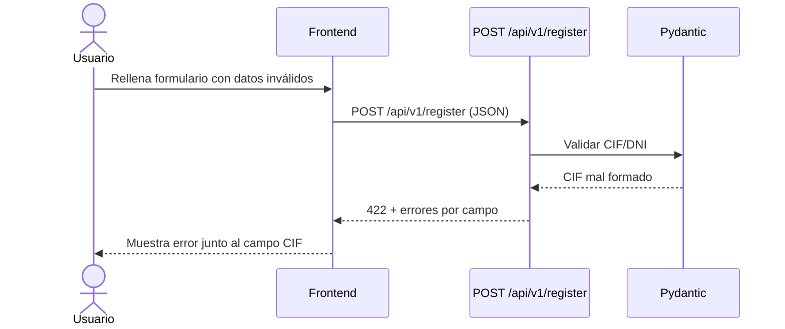
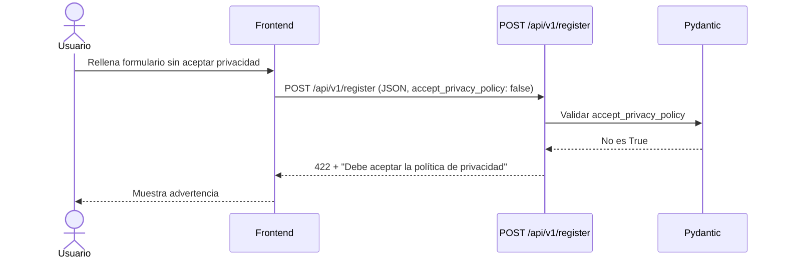

# Design — Registro

> Documento de diseño del módulo de registro basado en los requisitos de `requirements.md`

---

## 1. Diseño técnico

### 1.1 Ubicación en el proyecto

El registro es un módulo independiente dentro del backend:

```bash
src/
├── auth/
│   ├── router.py      # Endpoints
│   ├── schemas.py     # Pydantic: validación de entrada/salida
│   ├── models.py      # SQLAlchemy
│   ├── services.py    # Lógica de negocio
│   ├── validators.py  # Helpers puros (checksum CIF/DNI), usados por schemas
│   ├── dependencies.py# Inyección de dependencias
│   └── exceptions.py  # Errores de dominio (CIF duplicado, etc.)
└── shared/
    └── ...
```

### 1.2 Modelo de datos

#### Tabla `companies`

| Columna | Tipo | Restricciones |
|---------|------|---------------|
| `id` | UUID | PK |
| `name` | str(150) | NOT NULL |
| `cif` | str(9) | NOT NULL, UNIQUE |
| `activity` | str(200) | NOT NULL |
| `risks` | text | NOT NULL |
| `created_at` | datetime | default now() |

#### Tabla `users`

| Columna | Tipo | Restricciones |
|---------|------|---------------|
| `id` | UUID | PK |
| `email` | str(255) | NOT NULL, UNIQUE |
| `hashed_password` | str(255) | NOT NULL |
| `phone` | str(15) | NOT NULL |
| `company_id` | UUID | FK → `companies.id`, NOT NULL |
| `accept_commercial` | bool | NOT NULL, default false |
| `created_at` | datetime | default now() |

**Relación**: `Company` 1 — N `User`.

### 1.3 Contrato de la API

#### `POST /api/v1/register`

**Request** (`application/json`):

```json
{
  "company_name": "Empresa SL",
  "cif": "B12345678",
  "activity": "Construcción",
  "risks": "Caídas, cortes",
  "email": "contacto@empresa.com",
  "phone": "612345678",
  "password": "Abcdef1234!",
  "accept_privacy_policy": true,
  "accept_commercial": false
}
```

**Response 201**:

```json
{
  "access_token": "eyJhbGciOi...",
  "token_type": "bearer",
  "user": {
    "id": "3f2a...",
    "email": "contacto@empresa.com",
    "company": { "id": "9c1b...", "name": "Empresa SL" }
  }
}
```

**Response 422** (formato por defecto de FastAPI):

```json
{
  "detail": [
    { "loc": ["body", "cif"], "msg": "CIF inválido", "type": "value_error" },
    { "loc": ["body", "password"], "msg": "La contraseña debe tener...", "type": "value_error" }
  ]
}
```

### 1.4 Validaciones con Pydantic

Todas las validaciones de entrada se declaran en `schemas.py` con Pydantic.
FastAPI devuelve automáticamente `422` con el detalle por campo cuando fallan.

- **Email**: tipo `EmailStr` (requiere `pydantic[email]`). Verifica "@" y dominio.
- **Contraseña**: `@field_validator` que exige mínimo 10 caracteres con mayúsculas, minúsculas, números y caracteres especiales.
- **Teléfono**: `@field_validator` con regex de fijo/móvil español.
- **CIF/DNI**: `@field_validator` que llama a los helpers de checksum de `validators.py`.
- **Privacidad**: `@field_validator` que exige que `accept_privacy_policy` sea `True`.

### 1.5 Decisiones técnicas

#### Checksum CIF/DNI

Los algoritmos viven en `validators.py` como funciones puras (testeables):

- **DNI**: Módulo 23 sobre los 8 dígitos para obtener la letra correcta.
- **CIF**: Algoritmo de dígito de control específico para personas jurídicas.
- **NIE**: Letra inicial X/Y/Z se convierte a 0/1/2 y se aplica algoritmo DNI.

Pydantic las invoca desde el `@field_validator`, no se validan en el servicio.

#### Contraseña

Se usará `passlib` con `bcrypt` para hashear la contraseña **una vez validada** por Pydantic. El hasheo se hace en el servicio, no en el schema.

#### Política de Privacidad

El campo `accept_privacy_policy` se valida con Pydantic (exige `True`). Si es `false`, se devuelve `422` antes de llegar al servicio o tocar BD.

#### Transacción

La creación de `Company` + `User` se hace en **una sola transacción atómica**.
Si falla cualquiera de las dos inserciones, se hace rollback y no queda nada en BD.

#### JWT

- Algoritmo: `HS256`.
- Claims: `sub` (id de usuario), `company_id`, `exp`, `iat`.
- Expiración: 30 minutos (`ACCESS_TOKEN_EXPIRE_MINUTES`).
- Clave secreta: `JWT_SECRET_KEY` (variable de entorno).

#### Migraciones

Alembic genera una migración que crea las tablas `companies` y `users`.

#### Configuración

Variables de entorno necesarias:

| Variable | Descripción |
|----------|-------------|
| `DATABASE_URL` | Cadena de conexión a PostgreSQL |
| `JWT_SECRET_KEY` | Clave para firmar los tokens |
| `JWT_ALGORITHM` | `HS256` |
| `ACCESS_TOKEN_EXPIRE_MINUTES` | `30` |

### 1.6 Alternativas descartadas

| Alternativa | Descartada porque... |
|-------------|---------------------|
| **Validar con funciones propias en el servicio** | Pydantic ya integra la validación con FastAPI (422 automático); validar a mano duplicaba código y perdía el detalle por campo. |
| **Validar CIF/DNI con API externa** | Dependencia de terceros, coste, latencia. Mejor implementar la lógica local. |
| **Usar sesiones en vez de JWT** | El registro debe devolver un token para que el usuario entre sin hacer login extra. JWT es stateless. |
| **Registro en dos pasos (verificar email)** | Complejidad innecesaria para la primera versión. Se añadirá en el futuro si es necesario. |
| **Un `User` por cada contacto de la empresa** | De momento el registro crea un único usuario por empresa. La relación 1-N queda preparada para el futuro. |

### 1.7 Stack del módulo

| Componente | Tecnología | Referencia |
|------------|-----------|------------|
| Framework  | FastAPI | Definido en `docs/02-architecture.md` |
| ORM        | SQLAlchemy 2.x | Definido en `docs/04-tech-stack.md` |
| Validación | Pydantic (`schemas.py`) + helpers en `validators.py` | Decisión técnica local |
| Auth       | JWT (access + refresh) | Definido en `docs/02-architecture.md` |

---

## 2. Diagramas UML

### 2.1 Diagrama de secuencia — Registro exitoso

```mermaid
sequenceDiagram
    actor User as Usuario
    participant FE as Frontend
    participant API as POST /api/v1/register
    participant Valid as Pydantic
    participant Svc as RegisterService
    participant DB as Base de Datos

    User->>FE: Rellena formulario de registro
    FE->>FE: Valida campos en cliente (UX)
    FE->>API: POST /api/v1/register (JSON)

    API->>Valid: Validar email, CIF/DNI, teléfono, contraseña, privacidad

    Valid-->>API: Todo ok
    API->>Svc: register(data)
    Svc->>Svc: Hashear contraseña (bcrypt)
    Svc->>DB: BEGIN; INSERT company + user; COMMIT
    DB-->>Svc: OK
    Svc->>Svc: Generar token JWT
    Svc-->>API: usuario + token
    API-->>FE: 201 + token + datos de usuario
    FE-->>User: Redirige a dashboard
```

### 2.2 Diagrama de secuencia — Error de validación



### 2.3 Diagrama de secuencia — Check de privacidad no aceptado



---

## 3. Estrategia de tests

> Durante la implementación se seguirá TDD: cada test se escribe antes que su código asociado.
> Solo tests de integración (ver `docs/ai/verification.md`).

### Mapa de trazabilidad

| Test | Qué verifica | Cubre R |
|------|-------------|---------|
| `test_register_success` | Registro completo y redirección | R7 |
| `test_register_missing_field` | Error por campo obligatorio vacío | R8 |
| `test_register_invalid_cif` | Error por CIF mal formado | R12 |
| `test_register_invalid_dni_letter` | Error por letra de DNI incorrecta | R12 |
| `test_register_weak_password` | Error por contraseña débil | R9, R10 |
| `test_register_invalid_phone` | Error por teléfono inválido | R13 |
| `test_register_invalid_email` | Error por email sin @ o dominio | R11 |
| `test_register_privacy_not_accepted` | Error por no aceptar políticas | R5 |
| `test_register_response_time` | Tiempo de respuesta < 500ms | RNF1 |

### Setup de tests

- Cliente HTTP: `httpx.AsyncClient` apuntando a la app FastAPI.
- BD de prueba: SQLite en memoria (o Postgres de test), recreada por test.
- Fixtures: `client` (AsyncClient con dependencias sobrescritas) y `db` (sesión de prueba con rollback).
- Configuración: `pytest` con `asyncio_mode = auto`.
- No se depende de servicios externos: la BD real y cualquier servicio externo se sustituyen por fakes.

---

## 4. Checklist de calidad

- [ ] ¿Cada campo del formulario tiene su validación?
- [ ] ¿Cada validación tiene su mensaje de error específico?
- [ ] ¿El check de privacidad bloquea el registro si no está aceptado?
- [ ] ¿Empresa y usuario se crean en una sola transacción?
- [ ] ¿La contraseña se hashea antes de guardarla?
- [ ] ¿Hay test para el happy path (registro exitoso)?
- [ ] ¿Hay test para cada error path (CIF, DNI, email, teléfono, contraseña)?
- [ ] ¿Todos los tests son de integración (HTTP + BD de prueba)?
- [ ] ¿El tiempo de respuesta cumple con < 500ms?
- [ ] ¿Hay al menos un diagrama de secuencia del flujo principal?
- [ ] ¿Se documentaron las alternativas descartadas y por qué?